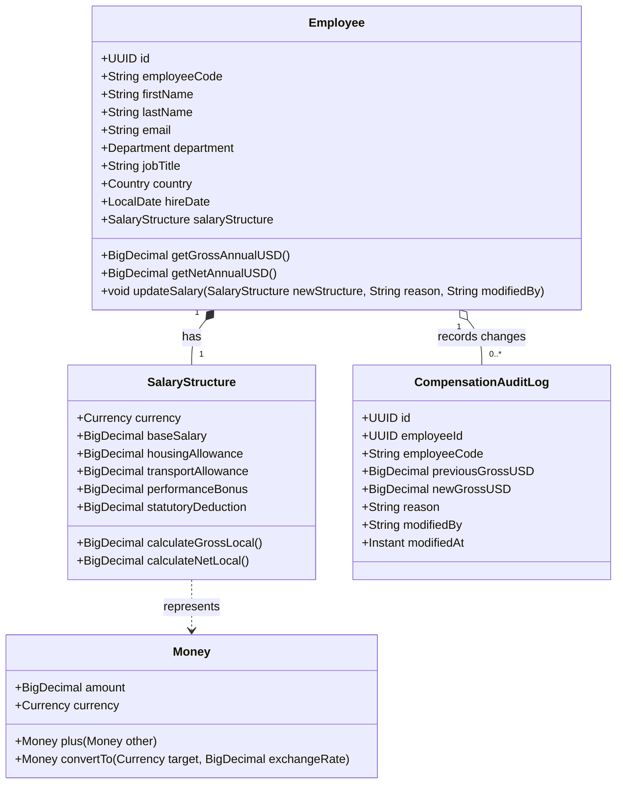

# ACME Global Salary Management System
## Architectural Design & Technical Blueprint

**Author:** Shubhasheesh Shukla  
**Role:** Candidate — Software Craftsperson (Java / Angular II)  
**System Type:** Full-Stack Web Application (Spring Boot 3 + Angular / Modern SPA + Relational DB)  

---

## 1. Architectural Philosophy & Principles
This application follows **Clean Architecture** and **Domain-Driven Design (DDD)** principles to ensure high cohesion, low coupling, and testability without framework pollution:
- **Domain Independence:** Core business entities (`Employee`, `SalaryStructure`, `Money`, `SalaryComponent`) are pure Java POJOs devoid of ORM/Web dependencies.
- **Port-and-Adapter Pattern:** Database persistence, external currency feeds, and web controllers interact with the domain through defined application interfaces (ports).
- **Zero Loss Financial Precision:** All monetary amounts use Java's `BigDecimal` with explicit scale and rounding modes. Floating-point types (`double`/`float`) are strictly forbidden.

```
+-------------------------------------------------------------------------+
|                          Web / UI Layer (Angular)                       |
|   - HR Analytics Dashboard   - Salary Adjustment Modal  - Employee Table|
+------------------------------------+------------------------------------+
                                     | REST JSON (HTTP)
+------------------------------------v------------------------------------+
|                         Presentation / REST API                         |
|   - EmployeeController       - AnalyticsController      - DTOs / Mappers|
+------------------------------------+------------------------------------+
                                     |
+------------------------------------v------------------------------------+
|                         Application Services                            |
|   - SalaryService            - AnalyticsService         - SeederService |
|   - CurrencyConversionService- AuditLogService                          |
+------------------+----------------------------------+-------------------+
                   |                                  |
+------------------v------------------+  +------------v-------------------+
|            Domain Core              |  |      Infrastructure Layer      |
| - Employee                          |  | - Spring Data JPA Repositories |
| - SalaryStructure, SalaryComponent  |  | - Relational DB (SQLite/H2)    |
| - Money, Currency (Value Objects)   |  | - Database Indexes & Schemas   |
| - CompensationAuditLog              |  | - CSV Export Adapters          |
+-------------------------------------+  +--------------------------------+
```

---

## 2. Domain Model & Class Diagram



---

## 3. High-Performance Strategy for 10,000 Employees
Managing 10,000 employees requires conscious engineering decisions to prevent CPU spikes and memory exhaustion:

### A. Database-Level Aggregations (No In-Memory Loops)
- Rather than streaming 10,000 records into JVM memory to compute totals, averages, and percentiles, queries leverage **SQL native aggregate functions** (`SUM`, `AVG`, `MIN`, `MAX`, `COUNT`) executed directly in the database engine.
- This reduces network payload from megabytes to sub-millisecond, sub-kilobyte JSON responses.

### B. Indexing Strategy
The relational schema defines targeted B-Tree indexes:
- `idx_employee_country_dept` on `(country, department)`: Accelerates multi-facet filtering.
- `idx_employee_salary_usd` on `(annual_gross_salary_usd)`: Enables rapid range queries and sorting.
- `idx_employee_search` on `(employee_code, last_name, first_name)`: Powers instant search autocompletion.

### C. Server-Side Pagination
- The REST API provides standard paginated responses (`page`, `size`, `sort`) with a default page size of 20 and maximum of 100.
- Total records count and pages are computed efficiently using indexed counts.

---

## 4. Multi-Currency Normalization Architecture
ACME employees are compensated in their local national currencies:
- **Supported Currencies:** `USD` (United States), `EUR` (Germany/France), `GBP` (United Kingdom), `INR` (India), `JPY` (Japan), `CAD` (Canada), `AUD` (Australia), `SGD` (Singapore), `CHF` (Switzerland), `BRL` (Brazil).
- **Base Reporting Currency:** `USD` (configurable).
- **Exchange Rates Table:** A dedicated service stores conversion ratios relative to USD (e.g., 1 EUR = 1.08 USD, 1 GBP = 1.28 USD, 1 USD = 83.50 INR, 1 USD = 155.0 JPY).
- Each employee record maintains both **Local Currency Structure** and a computed, indexed **USD Normalized Annual Salary** to enable seamless global aggregations.

---

## 5. REST API Contract Overview

| Method | Endpoint | Description | Query Parameters |
| :--- | :--- | :--- | :--- |
| `GET` | `/api/v1/employees` | Search and filter employees with pagination | `search`, `country`, `department`, `minSalary`, `maxSalary`, `page`, `size`, `sort` |
| `GET` | `/api/v1/employees/{id}` | Get employee by ID with full component breakdown | — |
| `PUT` | `/api/v1/employees/{id}/salary` | Update salary structure with audit reason | — (Body: `SalaryUpdateRequest`) |
| `GET` | `/api/v1/employees/{id}/audit-logs` | Get salary audit history for employee | — |
| `GET` | `/api/v1/analytics/overview` | Executive KPI metrics (Headcount, Total Payroll USD, Average, Median) | `country`, `department` |
| `GET` | `/api/v1/analytics/by-department` | Payroll distribution grouped by department | — |
| `GET` | `/api/v1/analytics/by-country` | Payroll distribution grouped by country | — |
| `POST`| `/api/v1/analytics/simulate-adjustment`| "What-If" simulation for planned raises | Body: `{ department, country, percentageIncrease }` |
| `GET` | `/api/v1/employees/export` | Export filtered employee salaries to CSV | Same filters as `/api/v1/employees` |

---

## 6. Architectural Decision Records (ADRs)

### ADR-01: Framework Selection — Spring Boot 3.x with Java 21
- **Context:** The role is Software Craftsperson (Java/Angular - II).
- **Decision:** Use modern Java 21 with Spring Boot 3.3+.
- **Consequences:** Provides Virtual Threads capability, modern Records for immutable DTOs, standard JPA/Hibernate support, and rapid setup.

### ADR-02: Relational Storage — Embedded SQLite / H2 with File Persistence
- **Context:** The specification asks for a relational database like SQLite, with frictionless local evaluation.
- **Decision:** Use an embedded relational database (H2/SQLite) running in file persistence mode (`data/acme_hrms.db`).
- **Consequences:** Zero external dependencies for the evaluator; the app runs out-of-the-box with `mvn clean spring-boot:run` while fully conforming to relational SQL semantics and indexing.

### ADR-03: UI Architecture — Angular / Modern Single Page Application
- **Context:** The role demands Angular craftsmanship with clean component hierarchy, reactive state, and accessible UI.
- **Decision:** Deliver a clean, modular SPA with dashboard charts, interactive data grid, search/filter controls, and modal drawers.
- **Consequences:** Responsive, instant user feedback, clear separation of presentation logic from API queries.
